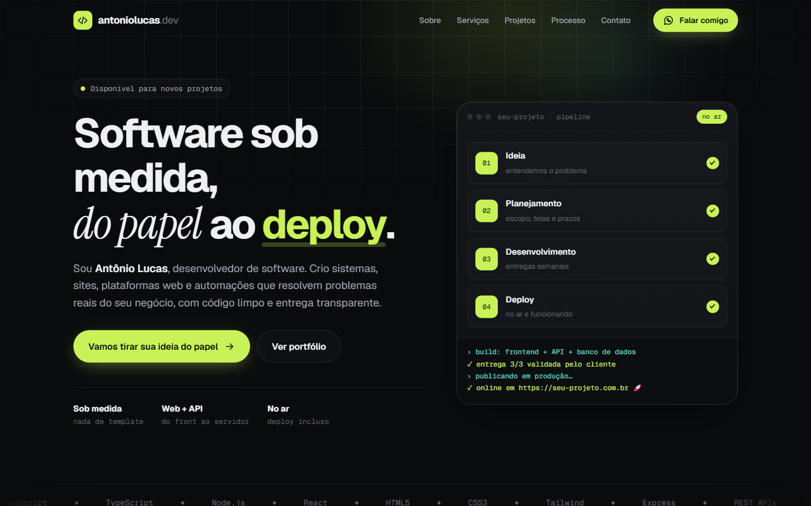
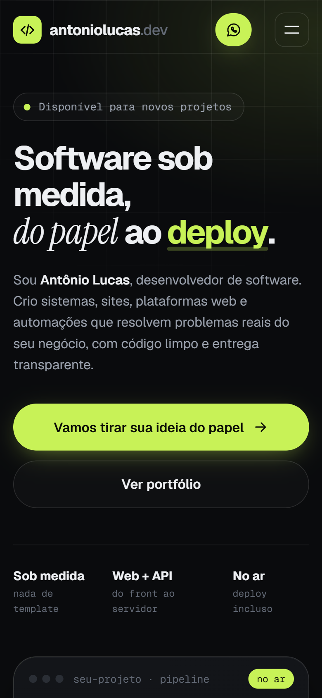
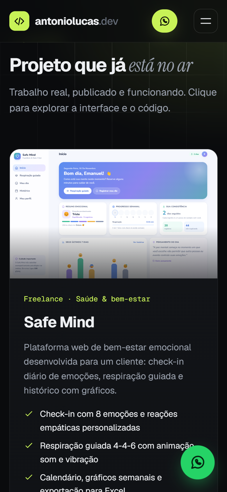
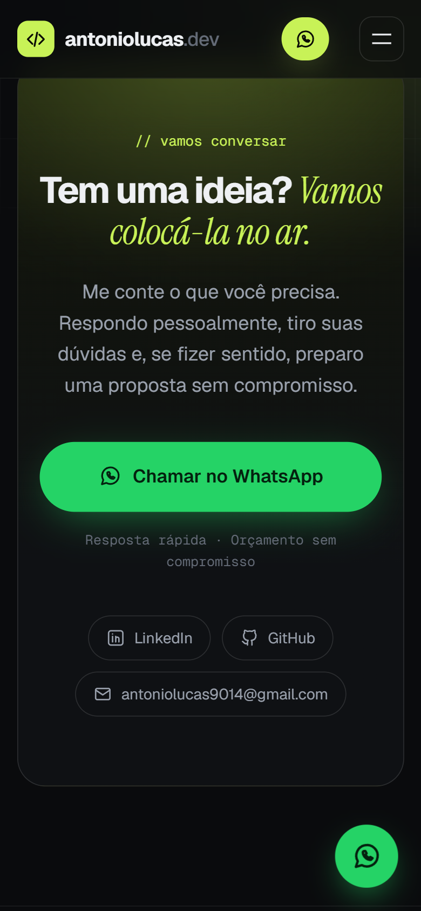
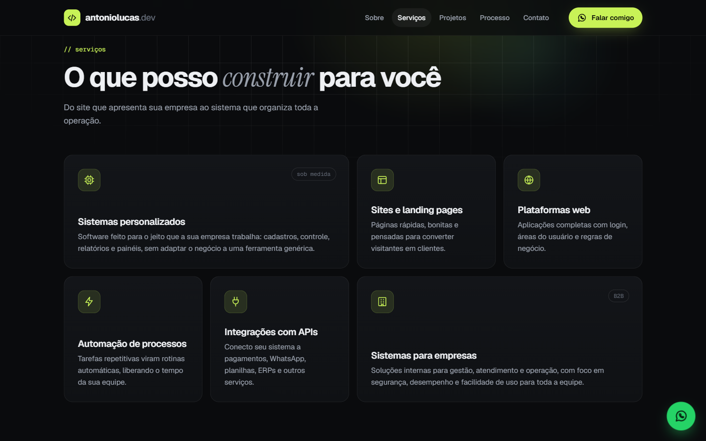
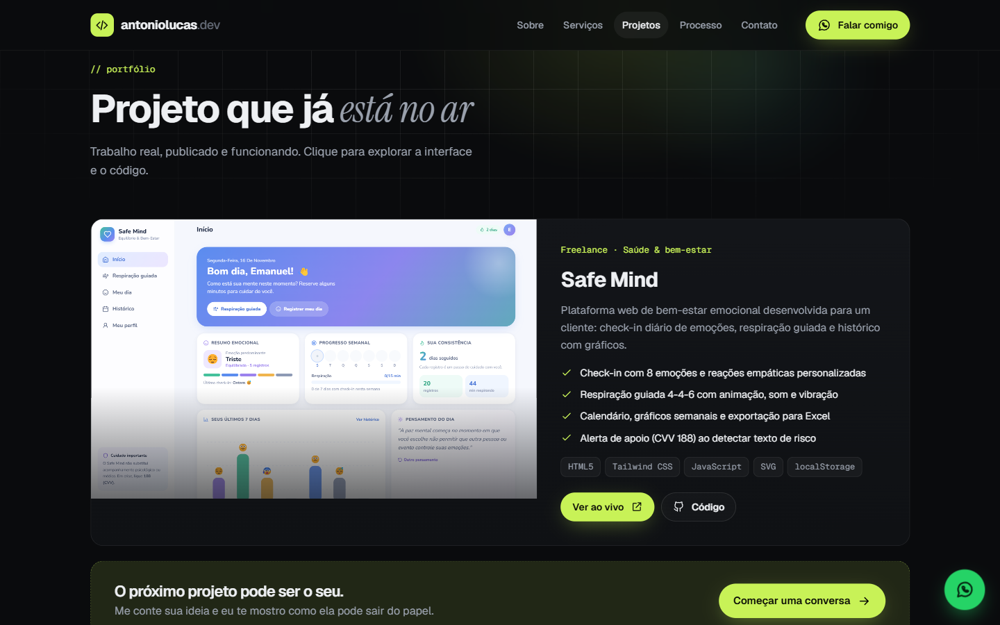
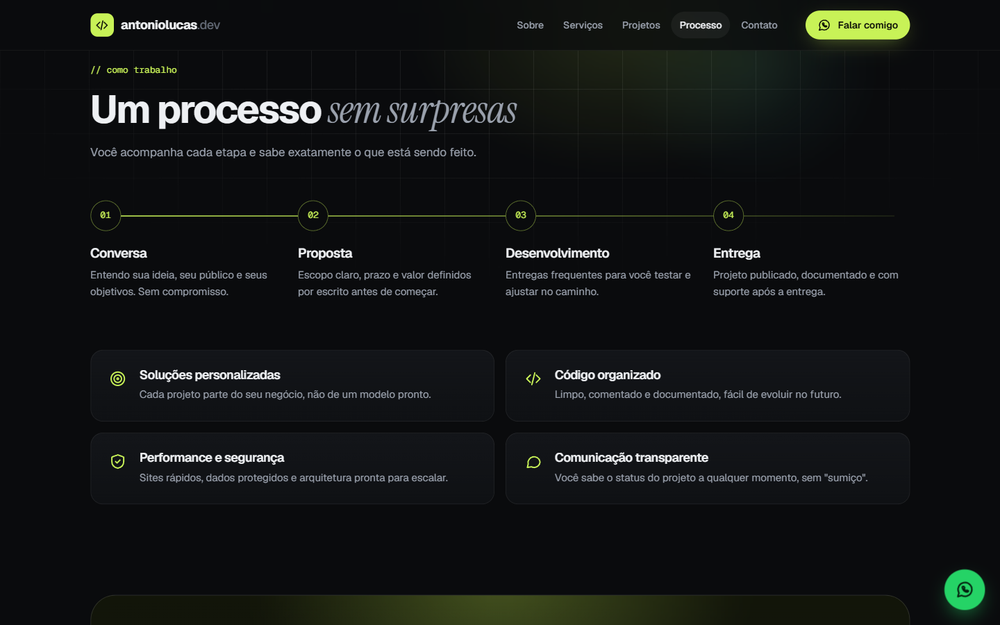
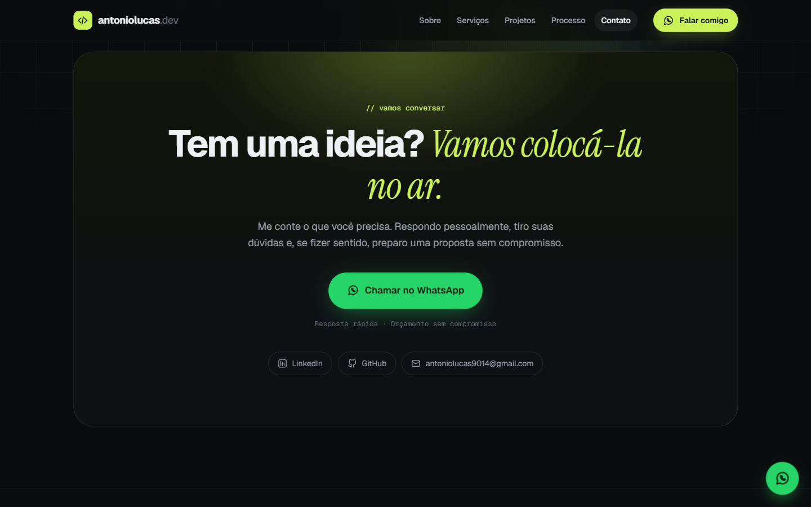

<div align="center">

# ⚡ antoniolucas.dev

**Portfólio e hub de captação de clientes para desenvolvimento de software sob medida.**

[**🌐 Ver o site ao vivo**](https://contact-us23.netlify.app/) · [📘 Documentação completa](https://github.com/ALucas314/Contact-Us/blob/main/docs/DOCUMENTACAO.md)




</div>

---

## 📌 Sobre o projeto

Site pessoal de **Antônio Lucas**, desenvolvedor de software formado em Sistemas de Informação pela UFPA.

**O objetivo:** não ser só uma vitrine, mas uma **ferramenta de captação de clientes**. Em poucos segundos o visitante entende quem eu sou, o que desenvolvo e quais projetos já entreguei, e chega a uma conversa comigo pelo **WhatsApp** com um clique.

**A identidade:** o conceito *"do papel ao deploy"*. No topo, um pipeline animado mostra um projeto passando por Ideia → Planejamento → Desenvolvimento → Deploy, com um log de terminal sendo digitado. É a assinatura visual do site, pensada para não parecer template.

## 📱 Telas

| Topo (celular) | Projetos (celular) | Contato (celular) |
|:-:|:-:|:-:|
|  |  |  |

<details>
<summary><b>Ver mais telas no computador</b></summary>

<br />

**Serviços**


**Projetos**


**Processo e diferenciais**


**Contato**


</details>

> A seção "Sobre" não aparece nos prints de propósito: ela tem a minha foto, que é protegida contra cópia no site.

## ✨ Funcionalidades

- **Conversão pelo WhatsApp:** 5 botões (topo, hero, projetos, contato e flutuante) abrem uma conversa com mensagem já escrita.
- **E-mail pelo Gmail:** abre a tela de escrever já com destinatário, assunto e mensagem.
- **Projetos dinâmicos:** os cards são gerados a partir de um arquivo de configuração, com imagem, funcionalidades, tecnologias e links.
- **Pipeline animado** no topo, que só começa quando aparece na tela.
- **Foto com proteção discreta:** aparece nítida na hora, desenhada em canvas (sem arquivo de imagem), com marca d'água e bloqueio de botão direito e arrasto.
- **Microinterações:** entrada das seções em cascata, brilho que segue o mouse nos cards e menu que destaca a seção atual.
- **Totalmente responsivo:** computador, tablet e celular, com menu "hambúrguer" no celular.

## 🧠 Decisões técnicas

| Decisão | Por quê |
|---|---|
| **HTML, CSS e JavaScript puros, sem build** | Carrega rápido, publica em qualquer hospedagem estática e é fácil de manter |
| **Tudo pessoal em um único `config.js`** | Trocar nome, WhatsApp, redes ou projetos não exige mexer no código |
| **Cards de projetos gerados por JavaScript** | Adicionar um projeto é só incluir um bloco no `config.js` |
| **Textos protegidos com `esc()`** | Nada do `config.js` vira HTML sem ser tratado: evita injeção de código |
| **`IntersectionObserver` para animações** | As animações disparam ao entrar na tela, sem cálculos a cada rolagem |
| **Foto desenhada em `<canvas>` a partir de dados embaralhados** | Não existe `` para salvar, e a foto não aparece como imagem no DevTools |
| **Foto nítida desde o carregamento, sem borrado** | A primeira impressão vem antes: o visitante vê a foto na hora, sem clicar nem esperar |
| **Respeito ao "reduzir movimento"** | Acessibilidade: quem desativa animações no sistema vê tudo direto |

## 🛠 Tecnologias

**HTML5 · CSS3 · JavaScript (ES6+) · SVG · Canvas API · IntersectionObserver · Google Fonts (Geist, Geist Mono, Instrument Serif) · Netlify**

## 🚀 Como rodar

Não precisa instalar nada. Abra o `index.html` no navegador, ou use um servidor local:

```bash
python -m http.server 5500
```

Depois acesse `http://localhost:5500`. Também funciona com a extensão **Live Server** do VS Code.

## ✏️ Como personalizar

Edite **`assets/js/config.js`**: nome, WhatsApp (55 + DDD + número), mensagem, e-mail, LinkedIn, GitHub e projetos. O passo a passo completo, incluindo como trocar a foto protegida, está na [documentação](docs/DOCUMENTACAO.md#-como-personalizar).

## 📁 Estrutura

```
├── index.html            # Estrutura e textos de todas as seções
├── netlify.toml          # Publicação e cabeçalhos de segurança/cache
├── assets/
│   ├── css/styles.css    # Identidade visual, layout e animações
│   ├── js/config.js      # ← dados pessoais e projetos (edite aqui)
│   ├── js/main.js        # Toda a lógica, em 6 seções comentadas
│   ├── js/photo-data.js  # Foto embaralhada (gerada pelo script)
│   └── img/              # Imagens dos projetos, prévia de compartilhamento e favicon
├── tools/
│   └── proteger-foto.mjs # Gera o photo-data.js a partir de uma foto
└── docs/
    ├── DOCUMENTACAO.md   # Manual completo
    └── screenshots/      # Imagens deste README
```

## 🔭 Próximos passos

- Adicionar novos projetos conforme forem entregues
- Seção de depoimentos de clientes
- Versão em inglês
- Domínio próprio e métricas de cliques no WhatsApp

## 👤 Autor

**Antônio Lucas** · Desenvolvedor de Software · Bacharel em Sistemas de Informação (UFPA)

[LinkedIn](https://www.linkedin.com/in/antonio-lucas-costa-araujo) · [GitHub](https://github.com/ALucas314)

## 🔒 Licença

**Todos os direitos reservados.** O código está público apenas para visualização. Não é permitido copiar, modificar, hospedar ou reutilizar este site, o design ou a foto sem autorização por escrito. Veja o arquivo [LICENSE](LICENSE).
